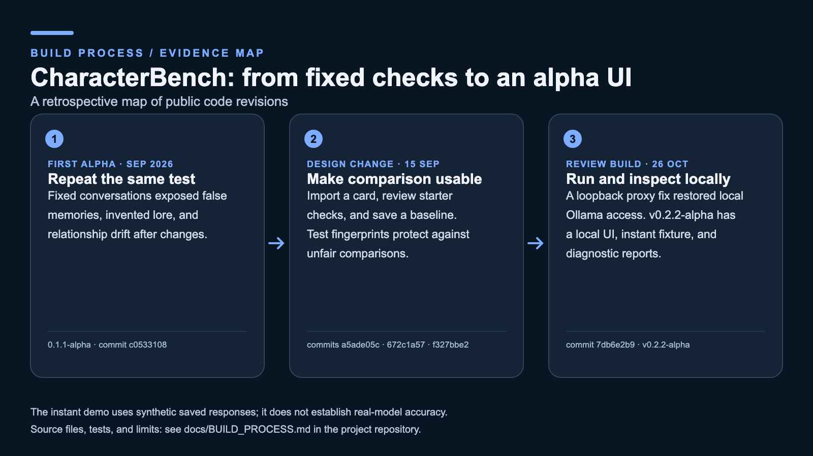

# CharacterBench: build process evidence

This is a retrospective map of public revisions, not an original sketch or a claim of external model accuracy. [The portfolio guide](../PORTFOLIO.md) explains the product and contribution credits.

| Stage | Design decision and evidence | Implementation to inspect |
| --- | --- | --- |
| Initial alpha | Repeat fixed character conversations so a changed model or prompt can be checked against the same behaviors. The [0.1.1-alpha publication](https://github.com/RayzerCat76/CharacterBenchmark/commit/c0533108) predates the local UI workflow. | [Evaluation runner](../run_eval.py), [example characters](../characters/), [test definitions](../tests/) |
| Reviewer workflow | A user should be able to import a Character Card, inspect starter checks, and save a baseline before comparing a later run. These steps were added in the [card-import](https://github.com/RayzerCat76/CharacterBenchmark/commit/a5ade05c), [starter-check](https://github.com/RayzerCat76/CharacterBenchmark/commit/672c1a57), and [baseline-comparison](https://github.com/RayzerCat76/CharacterBenchmark/commit/f327bbe2) revisions. Test fingerprints prevent a changed test suite from masquerading as a like-for-like comparison. | [Card import](../card_import.py), [UI server](../ui_server.py), [comparison workflow](../compare_models.py) |
| Current review build | A local Ollama connection failed behind system proxies; the [loopback fix](https://github.com/RayzerCat76/CharacterBenchmark/commit/7db6e2b9) led to [v0.2.2-alpha](https://github.com/RayzerCat76/CharacterBenchmark/releases/tag/v0.2.2-alpha). The instant demo and [UI recording](demo-0.2.2-alpha.mp4) show the present workflow. | [Quick start](../README.md#quick-start), [self-test](../self_test.py) |

The instant demo uses saved synthetic responses with deliberate character-behavior failures. It demonstrates the report interface and scoring pipeline; it is not evidence that a real model improved. A sanitized real-model before/after case remains useful external-validation evidence.
